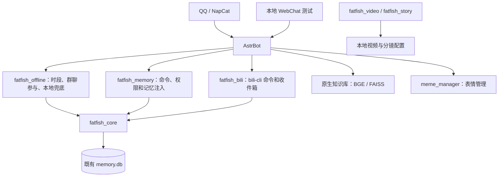

# FatFishLife 当前架构

AstrBot 负责平台接入、人设、会话、知识库和工具调度。插件只保留各自的行为；跨平台数据由不依赖 AstrBot 的 `fatfish_core` 提供。视频与分镜模块独立运行。



## 数据边界

| 数据 | 实现与位置 | 处理方式 |
| --- | --- | --- |
| 私人/公开事件、人设、主人、总结、札记 | `MemoryStore`，原有 `memory.db` 表 | 沿用原路径、表和权限，不搬库 |
| 记忆上下文 | `build_context` | 私人内容限主人私聊，原始聊天限相同平台与会话；候选和输出长度受限 |
| 离线控制、通知、用量、每日口令 | `StateStore` / `RuntimeStore`，`runtime_state` 表 | 启动时加载；需要持久化时写入 |
| QQ/B 站共用离线信号 | `read_offline`，`offline/signal` | B 站直接读取统一状态；手动切换立即发布 |
| B 站收件箱去重 | `SeenStore`，`seen_keys` 表 | 旧 JSON 首次导入，保持原有有界集合逻辑 |
| 群聊热状态、参与概率、短期上下文 | offline 插件内存 | 不把每个高频消息另存为数据库状态 |
| 原生知识库文档、块和向量 | AstrBot 的 `kb.db`、`doc.db`、FAISS | 使用 AstrBot 原有检索链路 |
| 公开选题候选 | B 站插件的 `discovery.db` | 独立的公开内容索引，不与私人记忆混用 |
| 表情与索引 | 社区 `meme_manager` 的数据目录 | 复用其导入和管理接口 |

## 安装与兼容

在实际运行 AstrBot 的 Python 环境中安装项目：

```text
python -m pip install -e <FatFishLife项目目录>
```

仅复制插件文件不够，插件需要能导入 `fatfish_core`。旧的 memory `store.py`、`context.py` 和 offline `state.py` 保留短兼容导入，其他调用者无需同步重写。`fatfish_lore` 暂作兼容插件保留，是否停用取决于原生知识库实际检索与注入验证。

`resolve_shared_db(data_root, configured=None)` 的路径优先级为：

1. 环境变量 `FATFISH_MEMORY_DB`。
2. 调用方显式传入的既有数据库配置。
3. `data_root/config/astrbot_plugin_fatfish_memory_config.json` 的 `db_path`。
4. `data_root/plugin_data/astrbot_plugin_fatfish_memory/memory.db`。

`FATFISH_DATA_DIR` 可以覆盖上面的 `data_root`。相对数据库路径仍相对于进程工作目录，部署时优先使用容器中的绝对路径。

首次加载时，旧 `state.json`、`offline.json`、`seen.json` 中的数据导入同一个 SQLite 数据库，原文件保留作回退参考。此后以 SQLite 为准，不会在重载时用旧 JSON 覆盖新状态。统一状态和去重记录位于专用表，不会成为模型记忆素材。备份正在使用的数据库应使用 SQLite 备份接口，或停止写入后同时处理 WAL。

## 离线模型与验证

默认意图才调用 Ollama；台词命中、冷却和群聊触发规则继续由 offline 插件处理。模式切换串行执行，正常时段的提前返回也会触发卸载；插件退出时等待切换完成，再以 `keep_alive=0` 卸载。离线提示不提供实时天气、新闻和价格信息，不能把缺少工具的数据当作当前事实。

针对性测试：

```text
python -m unittest discover -s tests -p "test_core.py" -v
python -m unittest discover -s tests -p "test_memory*.py" -v
python -m unittest discover -s tests -p "test_offline*.py" -v
python -m unittest discover -s tests -p "test_daily_apple_pie.py" -v
python -m unittest discover -s tests -p "test_bili_plugin.py" -v
```

这些测试覆盖旧数据导入不回放、隐私隔离、命名空间、去重、离线与在线切换和每日口令。模型输出、嵌入服务、知识库效果、真实账号与服务器启动仍须做运行验证；单元测试结果不代替这些检查。本地 WebChat 会经过真实 AstrBot 管线，回复回到本地页面，可用于验证而不向 QQ 联系人发测试消息。

## 六系统映射

| 系统 | 现状 | 位置 |
| --- | --- | --- |
| 记忆 | 已统一 | `fatfish_core.memory.MemoryStore`、`build_context`，QQ 与 B 站共用 `memory.db` |
| 行为 | 分散 | offline 的 `Scheduler`、`GroupEngagement`；bili 的自动回复与去重策略 |
| 推送 | 分散 | bili 私信、life 说说、offline 通知，各自调用平台接口 |
| 收发 | 平台原生 | AstrBot 事件与 `event.send`，尚未抽象成统一端口 |
| 检测 | 分散 | offline 峰谷/节假日判断；bili 登录态、风控、折叠检测 |
| 理解 | 部分统一 | bili `build_context`；offline 本地 Qwen 兜底；正常对话走 AstrBot LLM |

数据层已经共享，行为、推送、收发、检测、理解仍是各插件自己的实现。

### 迁移顺序

1. `fatfish_core.behavior`：冷却、触发条件、概率衰减，离线与 B 站共用。
2. `fatfish_core.push`：统一 `push(platform, target, text, meta)`，平台差异放适配器。
3. `fatfish_core.io`：平台端口注册，新平台只实现 `send/read` 两个方法。
4. `fatfish_core.detect`：峰谷、节假日、登录态、风控统一返回结构化结果。
5. `fatfish_core.understand`：按场景选云端或本地模型，统一超时与降级。

迁移时保持现有命令与配置不变，只替换内部调用点，避免破坏已验证的行为。
