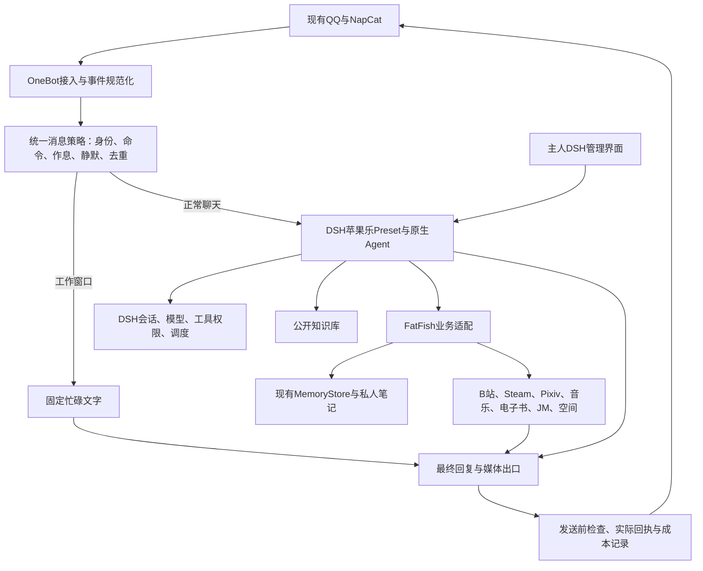

# FatFishLife 全面迁移 DSH 实施方案

日期：2026-10-28。状态：**实施中；QQ桥已通过隔离DSH加载与本地模拟收发，生产未切换**。目标为已安装的官方 DeepSeek Harness 桌面版，不再以 AstrBot 为运行底座。

后续已按下表部分接入desktop的KB/Obsidian/MCP与人格；QQ仍由旧系统承担，尚未完成最终切换。最新核查发现生产MCP声明仍指向旧记忆库；资产复制与运行切换分开记状态。新验证使用独立Python和模拟平台，不凭安装或监听端口宣称接入完成。

每个阶段开发前最好查查目前互联网上是否已有成熟项目代码或实现/架构值得复用, 不要重复造轮子

## 实施记录（逐项更新）

| 单元 | 代码/准备 | 隔离验证 | 生产/真实账号 | 证据 |
| --- | --- | --- | --- | --- |
| P0.1 数据与配置基线 | 已完成 | 1,618文件哈希一致；11个SQLite快照完整性检查通过；WAL恢复/禁止覆盖2项测试通过 | 只读旧环境，无切换 | `scripts/dsh_migration_baseline.py`；私有备份位于`outputs/dsh-migration/baseline-20261028-012734` |
| P0.2 独立Python | 已完成 | Python3.12.10；base为系统Python，prefix为`.tools/dsh-python` | 未用于生产 | 不依赖AstrBot虚拟环境 |
| P0.3 版本与来源 | 已记录DSH0.2.1-rc.3和QQ桥0.9.6 | 发布包已获取，后续准备脚本检查SRI与补丁匹配 | 社区插件尚未挂生产profile | `dsh/upstream-lock.json`；QQ桥BSD-3-Clause |
| P1 QQ入口与工具边界 | 策略层`dsh/policy.mjs`+适配层`dsh/runtime-adapter.mjs`完成；桥补丁`scripts/prepare_dsh_onebot.py` | **33项通过**（22策略+11适配模拟，不能单独算完整DSH端到端）；已补足有效@下非主人命令继续传正文的断言 | 未连接真实QQ | `node --test dsh/tests/*.test.mjs`；真实宿主证据见P1.2 |
| P1.2 真实宿主隔离验收 | 本地适配tarball安装进一次性Web profile；保留BSD许可证、上游SRI，未修改ASAR或放宽版本检查 | **8项通过**：原生peer解析、带鉴权loopback WS、忙时零模型调度、真实传输戳一戳、非主人命令无后台回执、主人命令、真实Agent作用域工具body被阻止；桥插件实际启动 | 未装生产desktop、未接NapCat、未发真实平台消息；普通聊天模型/完整人格请求尚未验收 | `scripts/dsh_native_smoke.py`；`outputs/dsh-migration/native-smoke/report-1793159212761171700.json` |
| P1.3 普通聊天原生Agent链与工具表面纠正 | 不再只替换dispatch计数；注册原生LlmAdapter本地mock，让真实Agent/preset/消息装配/最终输出走完。移除P1社交作用域的7个QQ工具注册及上游编程/管理平台提示；人格挂载失败改为终止创建 | **14项原生检查通过，4次本地mock模型调用，收费/真实平台发送均0**。正常消息的模型请求带完整2096字人格；只发最终文字；生成中静默/进入忙时拦截；402不外泄；缺失人格零模型调用。38项Node、2项归档回归通过 | 未安装生产desktop、未退出应用或改旧QQ连接；云端/本地真实模型的口吻与媒体出口仍待验收 | `outputs/dsh-migration/native-smoke/report-1793175138590416300.json`；原先guard虽拦执行，同作用域注册仍在模型工具schema中可见，现已在注册处收回；内核PTC模式保留的run_code运输层仍受guard约束 |
| P2.1 人格preset | `dsh/preset-apple-le.yml`由`apple-le-core.md`生成：persona插件+time-context，tools为空 | YAML可解析；persona 2097字符；`<#0.6#>`禁标记规则在内；身份不写进人格，由policy的ownerId提供 | 未挂载到生产profile | `.tools/dsh-python`装pyyaml校验通过 |
| P2.2 记忆MCP服务 | **改用官方 mcp SDK 2.x 的 MCPServer**（`FastMCP`已改名）；9个工具；挂载样例`dsh/mcp-fatfish.yml`走`@deepseek-ai/dsh-mcp-client` stdio | 官方MCP客户端stdio握手通过：工具列举、recall命中、只读模式下remember被拒 | 未接DSH宿主 | 手写JSON-RPC已删除；DSH官方有`guide/mcp-memory` |
| P2.3 脱敏观察 | `fatfish_core/observe.py`：凭据键整段掩码、Bearer、QQ号、手机、邮箱、Windows路径 | 6类样本掩码正确，`summary()`检出0处泄漏 | 未接生产日志 | 未用presidio（重且对中文QQ号无优势），按明确范围自实现 |
| P2.4 公开KB选型 | **改用`htcqp802/dsh-knowledge-base` 0.1.5**（MIT，仅pdfjs-dist一个依赖，FTS5/BM25）；已下载到`.tools/dsh-vendor/kb`并核对SRI | 包335KB，SRI匹配，`cordis.patch.yml`提供kb_query/kb_import/kb_list/kb_update/kb_delete | 未装到profile | 否决`Soren-ABT/dsh-knowledge`：AGPL-3.0且带onnxruntime+transformers，体积与许可都不合适 |
| P2.5 私人笔记选型 | `dsh-obsidian` 0.2.6（MIT，1个依赖yaml，npm可装）；已下载核对SRI | 包16.6KB，`cordis.patch.yml`单行挂载 | 未装到profile | `gxpppp/dsh-obsidian` 0.4.0零依赖更轻但未发npm；P2只用只读查询，写入留主人单独验收 |
| P2.6 群风格候选整理 | `scripts/migrate_style_candidates.py`：从self_learning的expression_patterns迁到候选区，过滤系统噪声 | 源251条→去重后197条候选入库生产，重复项按hits累加 | **已写生产库** | status=candidate，需主人`/记忆 通过`才进长期记忆 |
| P2.7 DSH插件安装 | `scripts/dsh_install_plugins.ps1`：退出检测→`dsh plugin --profile desktop add`（`--profile`必须紧跟`plugin`）→MCP与preset写入profile patch | **部分跑通**：kb-knowledge-base 与 dsh-obsidian 生效（`kb.sqlite` 自动创建、MCP 子进程被 DSH 拉起、persona 渲染正确）；`dsh-onebot-qq` 装上了但**挂载失败**（见 P3.1） | KB与Obsidian已装desktop profile；QQ桥已卸载避免加载报错 | `.env` 规范化为 `DEEPSEEK_API_KEY` + `FATFISH_MEMORY_DB`（正斜杠，已 gitignore） |
| P2.8 工具白名单纠错 | 原以为有`dsh-agent-tools`可配allow列表，实际不存在；已撤回，preset恢复零工具 | `--dump-default-config`里无该包，挂上去会让preset加载失败 | — | 工具白名单由preset的`plugins`本身决定，不挂`tool-*`即无工具 |
| P3.1 QQ桥兼容（新证据覆盖旧阻塞判断） | 旧目录链接安装曾缺peer/自身ws依赖；改为适配tarball安装到profile包树 | 本机0.2.1-rc.3原生安装回退确实提供内部peer；桥已启动且P1.2通过，**不是必须安装npm旧版内部包或等待上游** | 生产仍未安装/切换；媒体出口与业务权限尚待整合 | `prepare_dsh_onebot.py --pack`；不使用allow-version、不复制ASAR包、不重写Agent |
| P3.2 TTS 接 MCP | `fatfish_core/tts.py`：从 AstrBot provider 抽出纯逻辑（合成+ffmpeg规整），音色/语速/ffmpeg 走环境变量；MCP 新增 `tts_check`/`tts_speak` | 官方 MCP 客户端实测：11 个工具在线；`tts_check` 66832 字节 RIFF 正确；`tts_speak` 落盘 `outputs/tts/tts.wav` 66208 字节 | 未接 QQ 出口（依赖 P3.1） | 复用现有 CosyVoice2 克隆音色，未换服务 |
| P3.3 STT | `fatfish_core` 暂未抽；AstrBot 用 SenseVoiceSmall（免费） | 未验证 | 未接 | 等 QQ 桥通了再抽，避免空转 |
| P4.1 B站接MCP | `fatfish_core/bili.py`：从插件抽出 CLI 调用（search/video/transcript/comments/feed/inbox），读默认开放，写需`FATFISH_BILI_WRITE=1` | 官方MCP客户端实测：16个工具在线；`bili_check` ok且writes=false；`bili_search` 返回真实结果；写操作被拦截 | 未接 QQ 出口 | 修正命令名：`bili auth status`（不是`account whoami`） |
| P4.2 Steam+图库接MCP | `fatfish_core/gallery.py`（兼容两种目录布局）；MCP 新增 `steam_price`/`steam_search`/`meme_stats`/`meme_find`/`meme_random` | 官方MCP实测21工具：`steam_price` 返回「Portal 2（620，CN区）¥35.00」；`meme_stats` 164张/4分类/0损坏；`meme_find` 按标签命中；`meme_random` 可挑 | 未接 QQ 出口 | Steam 复用现有 `fatfish_core/steam.py`，无新依赖 |
| P4.3 资产迁移 | `scripts/migrate_assets.py`：SQLite在线备份+目录复制到`FatFishLife/data/`；`scripts/import_knowledge_to_dsh.py` 导入DSH KB | memory.db 4845 events/209 candidates/5 journals/1 block；memes 164张40MB；knowledge 29文件→KB 28条入库并建FTS，检索「德克萨斯」「黑流树海」均命中 | **资产副本已迁，生产MCP尚未切到新库** | `.env`指向新data不等于desktop MCP的显式env已改变；见P4.7 |
| P4.4 运营规矩迁移 | `dsh/rules.md`：B站刷首页+推荐理由、21:00标签学习、23:50日记与动态、峰谷模型切换、忙时固定话术、静默优先，逐条写明时间/阈值/出口 | 交叉验证发现配置与实际不符：`local_model_url` 6193 是 **MiniCPM5-2B(llama-server)**，不是 Ollama；Ollama 的 qwen2.5:1.5b 中文能力弱（问"你是谁"回英文），降为兜底 | 未接定时器 | `fatfish_core/local_llm.py` 双后端，实测 minicpm/ollama 均 ok |
| P4.5 自检脚本 | `scripts/dsh_selfcheck.py`：10 项一次跑完，PASS/WARN/FAIL 三档，`--json` 可机读 | 实测 **9/10 通过**：memory/图库/知识库28条/插件/preset/MCP23工具/本地模型/TTS/B站全 OK；唯一 FAIL 是 QQ 桥（未安装，QQ 仍由 AstrBot 承担） | 需手动跑 | 端口检测改用 socket，避免 netstat 中文编码炸 |
| P4.6 自检验收纠正（10/28上午，覆盖P4.5旧结论） | 默认TTS检查改为本地preflight；真实合成须显式`--live-tts`；MCP的tts_check不再合成；本地模型只探端口、不推理；拒绝把端口/包声明当运行验收 | **实测5 PASS / 4 WARN / 1 FAIL（QQ桥）**；9项新增测试、33项既有桥策略测试通过；官方MCP客户端握手23工具，实际调用tts_check返回synthesis_requests=0、synthesis_verified=false | 未改desktop profile、未重启DSH、未连接QQ；旧MCP常驻子进程需下次重载才能取得新实现 | JSON模式的FAIL返回非零，Windows编码回归通过；TTS不再把DeepSeek key当硅基key；回执`outputs/dsh-selfcheck-20261028/` |
| P4.7 并发修改复核与安装模板 | 保留用户新增MCP/资产代码；仓库MCP模板改指向项目data；自检加入资产库/生产MCP声明路径不一致提醒；补全KB/Obsidian的完整SRI；安装器默认不装QQ，显式启用时安装适配tarball | 新增2项归档测试通过；自检回归现10项通过；PowerShell安装器语法解析通过 | **生产MCP仍指旧库**，本轮未重启/改desktop配置；自检仍应报QQ未切换 | `.env.bak`未读未改未提交；后续受控退出DSH、备份profile再切MCP路径，不能覆盖新产生的数据 |
| P3.4 发送概率基线与回执决策 | `dsh_behavior_snapshot.py`只导出行为字段；复用`progressive_probability`实现`fatfish_core/delivery.py`，MCP提供prepare/finish；明确拒绝把生成/选图当发送成功 | 8项新回归通过，`test_dsh_*`现22项、原概率3项通过。**实际原生TTS15%**；10%/180秒/80字属于未安装旧路由残留；表情35%+10至90%；动态20%+20至100%且有意愿/安全/平台权重 | 配置快照已存本地data；**最终回复媒体出口尚未挂入生产**；动态和评论执行器未迁完 | 插件停用状态从preferences读取，proactive保持停用；用户已授权完整DSH验收后停AstrBot再验并卸载，条件尚未满足 |
| P3.5 音频规整与隔离 | 复用旧适配的`-ignore_length 1`解码流式WAV，核验24k单声道完整帧；解码失败显式失败供文字兜底；每次TTS独立目录避免并发覆盖 | 解码失败与完整帧mock通过；本轮无收费合成/真实QQ播放 | 等媒体出口联验 | memory只读权限保持，单独MEDIA_WRITE不授权记忆写入 |
| P6.1 白盒管理插件 | 已修原生表单缺失根因：Settings只投影volatile字段；回复/时间窗/语音/表情/运营分组加实时标记和保存监听，更新服务/缓存/生效版本；现有QQ策略在入口及最终出口读取新配置并保留冷却去重 | **16项原生检查、39项Node、26项Python迁移检查通过**；原生Settings保存语音15→16→15，服务与缓存同步；自定义忙时窗口已有验证 | **已装日常desktop并获授权重启**；桌面已看见运行组件，缓存重新写出且15%/35%/silent=true/合成关闭；最后桌面鼠标保存因helper拒绝访问尚未验收，真实QQ未接 | `report-1793184072006285100.json`；不能把原生隔离保存说成桌面鼠标保存。安装/备份详见交接 |
| P4.8 社区文本插件安装 | 固定Git来源的`dsh-plugin-bilibili`0.2.4与`dsh-find-plugin`0.4.0（MIT），保留许可证，归档SHA与适配说明；只注册B站search/video/subtitles，发现插件安装提示指desktop；bili-cli0.6.0原已装，继续复用 | 原生宿主实际加载；B站真实资料读取成功；GitHub联网发现3个结果，未降级；无收费模型/TTS或平台写入 | **两插件已装并启用日常desktop**，原KB/Obsidian保留；未给QQ开放管理能力；本项不代表评论、动态或完整运营已迁完 | `scripts/prepare_dsh_community.py`、`dsh_native_smoke.py --community`；工坊1.6.2因写死web暂不安装，安装器已移除该项 |
| P3.6 可选配音服务 | 现用硅基流动保持；新增ElevenLabs/MiniMax薄REST适配及模型/音色/语速选项；专用密钥隔离，ElevenLabs仅引用用户桌面env路径；默认allowSynthesis=false | **8项提供商回归通过**；ElevenLabs真实只读API返回9模型、21音色；合成请求0。输出鉴权、PCM转WAV、MiniMax业务码、切换不混用key/URL、媒体权限不授权记忆写入已测 | 未试听/未验证QQ播放；默认不切换现用音色，发送概率仍15% | 本机`data/dsh/elevenlabs-catalog.json`供原生配置显示账户选项，未提交密钥/音色私有缓存；官方API来源见`dsh/README.md` |
| 后续执行心跳 | 用户要求每3小时继续本对话，已创建thread heartbeat“继续 FatFishLife DSH 迁移” | ACTIVE；未授权绕过额度，未变化时保持安静 | 继续核对最新代码和本表，避免重复执行；本轮用户已授权重启安装，但未满足停AstrBot条件 | 不创建独立任务，不用系统cron替代；任务完成或需用户操作时才通知 |
| P2～P6 | 以上已列明部分单元，其余待实施 | 依逐项记录，不作整阶段通过 | 最终切换未完成 | 按下文顺序推进 |

基线使用SQLite在线备份API，每个库各自一致；运行中的多个文件不构成同一瞬间的全局快照。P5切换仍须停止旧写入、备份最后增量。私有备份含登录态，位于Git忽略目录，不提交其内容或清单。

## 1. 最终交付与范围

迁移完成后：

1. DSH负责Agent、模型、会话、工具、管理界面与任务调度。
2. QQ继续使用现有QQ帐号与NapCat，不重新登录、不改成需要新建帐号的QQ开放平台Bot。
3. 迁移当前有效功能，合并重复职责；不把20个现用插件原样变成20套新引擎。
4. 保留现有身份、人设、记忆、笔记、图库、音色、订阅、草稿、审核和发送回执。
5. 新系统无需AstrBot进程、Python虚拟环境、原生知识库或启动脚本；AstrBot目录最终仅保留冷备份。
6. 文档、可读配置、源码、版本锁和逐阶段测试一并交付。实际安装、模拟、真实帐号验收分别记状态。

前期研究依据见[插件选型与源码核查](HARNESS_MIGRATION-20261027.md)。本文件是实施顺序和交付边界的主方案；下述选择遇到兼容问题时按明确条件处理，不用忽略版本检查充当成功。

## 2. 已确认的本机基线

| 项目 | 本轮确认结果 |
| --- | --- |
| DSH程序 | `D:\dsh\DeepSeek Harness.exe`，0.2.1-rc.3 |
| 随桌面版CLI | `D:\dsh\resources\runtime\cli\bin\dsh.cmd` |
| 实际使用的数据根 | `C:\Users\kongb\.dsh`；当前Host进程明确使用其中的desktop profile |
| 实际profile | `C:\Users\kongb\.dsh\profiles\desktop` |
| 桌面第三方依赖清单 | 初始快照为空；当前已声明dsh-knowledge-base与dsh-obsidian，QQ桥未装生产 |
| 旧D盘目录 | `D:\DeepSeekHarness`是旧启动器/数据，保留但不自动合并 |
| AstrBot插件目录 | 当前24个：20个未被原生禁用，4个禁用；安装/启用不等于真人功能全部通过 |
| 既有纯业务 | MemoryStore、Steam、查询证据、成长、图谱、投稿草稿等已有可复用代码 |

桌面插件只能在桌面版完全退出后，由随桌面版CLI管理desktop profile；不修改 `app.asar` 或签名资源。测试另用新数据根的Web profile与模拟平台，测试通过后再接桌面管理界面。

## 3. 目标架构与代码边界



### 3.1 保留一个社交Preset和一个管理入口

- `apple-social`：固定苹果乐人格、当前会话资料、按权限开放的公开查询和媒体能力。
- 主人控制面：在本地DSH管理界面或已认证的主人命令入口管理设置、记忆导入、订阅与发布审核。
- 普通QQ用户不获得DSH编程助手的整套shell、文件、插件安装、凭据管理、跨会话发送能力。
- 人格文本只保留一个权威来源。日常风格参考、知识与私人记忆各有边界，不再同时维护多份互相覆盖的人设。

### 3.2 自研范围控制在适配与业务规则

建议在项目内增加一个 `dsh/` 外部插件bundle，内部按策略、数据、媒体和工具分模块；包名可暂定 `dsh-fatfish-life`。它负责注册既有业务到DSH，不重写模型客户端、Agent循环、通用RAG或第二套会话存储。

Python纯业务通过一个长期存在的薄服务供宿主调用，优先使用DSH已有MCP/进程通信能力。主体、平台、完整会话与公私范围由宿主绑定，不能让模型提交任意数据库路径或冒充另一个会话。

Python环境独立建立，不能继续使用 `D:\Code\Apps\AstrBot\.venv`。当前 `fatfish_core/voice_policy.py`仍有AstrBot导入；迁移时把可复用合成/音频逻辑与旧事件、消息类适配拆开。数据库默认路径和配置解析也须去掉AstrBot目录假设。

## 4. 技术选型决策

| 领域 | 主选 | 采用方式与条件 |
| --- | --- | --- |
| Agent、会话、持久化、压缩 | DSH原生 | 直接复用已装0.2.1-rc.3，不另造Agent/会话引擎 |
| 人格 | 官方persona与agent-preset | 配置固定apple-le、稳定前缀和经审核的对话样例；核对最终模型请求 |
| 工具权限 | 官方restrict与guard | 在agent作用域限制继承工具，并在执行前校验可信主体、实际目标和资源范围 |
| QQ桥 | `dsh-onebot-qq`的受控适配副本 | 优先做兼容冒烟；修非主人拒绝回执、peer声明、默认工具面与跨目标发送 |
| QQ备选 | `flyinstar/dsh-qq-bridge` | 仅在主选适配过大时替换；关闭主动/续聊/复读/独立记忆/密钥轮换并验证工具边界 |
| 公开KB | `Soren-ABT/dsh-knowledge` | 先公开资料和BM25；验证当前DSH加载、来源与召回；不放主人私库 |
| 私人/领域记忆 | 现有MemoryStore | 数据语义保留，薄适配；不同时启用第三方自动记忆引擎 |
| 图库 | `dsh-biaoqingbao`为主改造候选 | 复用管理、标签和选图；QQ投递、收藏300×300与真实回执由适配层补齐 |
| TTS/STT | 现用CosyVoice2/SenseVoice优先 | 保留现用音色与账号；抽离客户端并重接媒体出口；multi-TTS作为设置/合成适配候选 |
| B站业务 | 既有bili-cli与FatFish业务 | 保留收发、订阅、去重和稿件审核；DSH文字检索插件仅在减少维护时选择性接入 |
| 定时任务 | DSH官方调度 | 每个任务一个稳定ID，避免第二套cron、后台线程和重复提醒 |
| 管理UI | DSH已有页面与插件配置 | 只补必要配置、状态和审核入口，不新建另一套后台 |

主选QQ桥兼容验收若失败，先判断是否仅元数据/接口薄改；若需要改写Agent循环或大范围依赖旧API，停止扩修，选择备选或仅复用传输/媒体部分。两个QQ桥不会同时连接同一帐号。

### 4.1 不能原样继承的社区行为

- dsh-onebot当前会向非管理员直接发“仅管理员可用”，需要在命令表之前分流。
- 普通QQ会话不能继承主人的编程preset；软提示不是硬权限。
- flyinstar默认主动发言、免@续聊、复读和密钥轮换，不符合初始迁移配置。
- 图库工具返回selected或Web卡片，不算QQ发送成功。
- Web朗读、浏览器STT，不等于QQ Record收发。
- Inspector整包的fetch捕获可能记录未脱敏headers/body，初期只用Session Inspector和本地模拟端点。

### 4.2 其他成熟项目的使用方式

- Obsidian：`mingzeng21/dsh-obsidian`0.2.6可作vault访问候选，先只读、限主人；它不替代私群权限或自动等价替代原KB索引。
- Pixiv：保留现有pixivpy3与refresh_token认证；`dsh-pixluna`的Cookie方案不作为强制换认证的理由。
- 音乐：现有cloudmusic是网易云搜索/点歌/热评。`doitian/dsh-music`可作DSH网页播放器候选，QQ点歌仍需媒体卡片/音频投递适配。
- 电子书：已有多源客户端优先保留；Calibre-Web MCP仅在已有对应服务时采用，不为迁移额外部署一套书库。
- Steam、JM、Updream：没核实到更合适的成熟DSH精确替代，复用现有底层业务。
- QQ空间：现有qzone_ultra已有独立daemon/API，优先脱离AstrBot日志与消息适配后复用，不重写登录和空间API。

所有候选固定仓库/包名、版本或提交及许可证。AGPL/GPL等代码保留授权说明；本机cloudmusic、ebooks的许可证来源需在复制源码前补核。不能因兼容性被拒就用版本豁免当通过。

## 5. 全部现用插件的功能迁移表

以下是20个当前未被原生禁用的插件。迁移按功能验收，不只检查新界面有没有同名按钮。

| 旧组件 | 迁移后的归属 | 必须保留/修复 |
| --- | --- | --- |
| fatfish_offline | 统一策略 | 每天工作窗口、主人识别、静默、冷却、群参与；移除工作窗口自由闲聊与重复发送捷径 |
| fatfish_memory | MemoryStore适配 | 人设关联、记忆查询/导入、总结/札记、历史整理、查询证据、成本入口 |
| fatfish_lore | 公开资料与图谱工具 | PRTS来源、证据、更新时间；与KB明确分工，不重复注入同一设定 |
| fatfish_obsidian | 受限私人笔记服务 | vault、增量同步、笔记查询和成长记录；替换对AstrBot KB manager的调用 |
| fatfish_style | 单一风格参考 | 已审核表达、完整会话隔离；不自动覆盖核心人格 |
| fatfish_voice | TTS客户端与音频处理 | 当前音色、语速、音频规整、缓存；不保留AstrBot provider/event继承 |
| fatfish_bili | B站业务工具与任务 | 收件箱、评论/私信、订阅、推荐、去重、暂停/风控、真实发送回执 |
| fatfish_life | 生活/成长与DSH任务 | 日记、成长、每日总结、草稿、原有授权内发布；统一外发门禁 |
| fatfish_story | Updream与审核工具 | 分镜、导出核验、具体版本预览/确认与稿件状态；不恢复旧模板视频链 |
| fatfish_steam | Steam工具 | 商店搜索与价格查询 |
| meme_manager | 新图库组件与QQ媒体适配 | 图片、标签、索引、收藏、语义匹配、概率与发送失败语义 |
| anysearch | DSH搜索或原客户端薄适配 | 实时检索/提取、来源与证据；同类搜索只暴露一个主入口 |
| cloudmusic | 网易云点歌工具 | 搜索、点歌、歌词/热评、QQ卡片或音频投递 |
| ebooks | 电子书业务工具 | 原有Calibre/Archive/Liber3/Anna/Zlib等已配置来源、搜索下载、文件/合并转发 |
| pixiv_search | Pixiv工具与订阅 | pixivpy3、现有认证、标签过滤、图片处理、订阅；凭据本机保管 |
| jm_cosmos | 受限JM工具 | jmcomic底层、搜索、打包、订阅；保留主人权限和文件投递 |
| qzone_ultra | 独立空间后端 | 登录态、浏览/评论/赞、发布、审核与回执；不经AstrBot中转 |
| self_learning | 采集/表达候选适配 | 有效采集和候选审核；不恢复目前关闭的自动人格演化、重复记忆或LLM hooks |
| SteamSaleTracker | 同一Steam服务与DSH调度 | 游戏/监控列表、历史、促销通知；合并查询客户端和定时入口 |
| token_controller | DSH用量与统一额度 | 限额、节流、实际请求/工具循环/嵌入/TTS成本；不再按群消息数冒充模型调用 |

### 不作为独立常驻插件迁移

| 旧组件/状态 | 处理 |
| --- | --- |
| emotionai：停用 | 不重新启用侵入式人格/thought注入；有价值的表达规则由固定人格承接 |
| fatfish_acceptance：停用 | 保留测试用例，不运行一次性诊断插件 |
| obsidian_sync：停用 | 与现用私人笔记职责重复，合并到一个入口 |
| proactive_chat：当前整体停用 | 主动消息能力可迁到原生调度，但保持关闭，单独验收后再启用 |
| fatfish_context / fatfish_stickers：只有旧源码 | 实际已无独立安装，职责并入历史处理和图库，不复制为新插件 |

停用状态、功能开关和订阅状态作为迁移数据保留；不因为新插件默认开启就复活旧能力。

## 6. 统一修复规则与验收用例

### 6.1 身份、后台命令与工具

- 身份从真实平台事件取得，配置保留一个权威主人映射；不把群管理员、任意AstrBot admin或消息自称当主人。
- 在命令解析、管理回复、权限拒绝和Agent创建之前区分主体。
- 普通用户的 `/help /stats /provider /stop /reset /new /plan /permission`及未知命令均作为普通正文处理；遵守聊天触发规则，不执行、不显示帮助、不发后台拒绝。
- 主人命令继续可用；管理详情只返回合适的主人通道，不把凭据与控制信息公开发群。
- 普通人格可按权限使用公开查询工具；私人记忆、任意文件、原始NapCat API、跨会话发送和发布不由模型自选权限。

**验收：**普通用户、群管理员、伪造主人三类主体逐条测试，管理动作计数0、管理模板发送0、状态不变；主人对应命令成功。直接/嵌套调用被禁工具，其真实业务body调用0次。

### 6.2 每天工作时段与消息触发

时区固定Asia/Shanghai，每天包括周末：`[09:00,12:00)`、`[14:00,18:00)`。

- 仅当前Plain正文明确叫“苹果乐”、真实@bot、真实戳bot可以触发忙碌回复。
- 引用里出现名字、OCR、其他关键词、回复bot旧消息、接续、随机、复读和主动补句均不能绕过。
- 忙碌文案由规则直接选定，上午带12点，下午带18点；不调用聊天模型、意图自由回复、知识库或媒体合成。
- 主人控制命令单独处理，不让工作窗口阻止管理关闭/恢复和排障。
- 手动在线不能绕过工作硬规则；闭麦优先于任何自动发声。
- 初始忙碌冷却建议群10秒、同用户60秒，配置可见；冷却内不排队补发。
- 正常时段保留明确配置的聊天策略，不接受社区插件偷偷开启的主动行为。

每天0:01 自动发送由我设置的固定话语, 支持多备选随机, 若因主机未开机等原因发送失败会在首次成功接入服务时再次尝试发送

**验收：**08:59/09:00/11:59/12:00/13:59/14:00/17:59/18:00、周末、同人连续追问、@别人、戳别人、10次连戳、重复message_id；工作窗口模型/检索/TTS调用均0。

### 6.3 人格、设定与真实查询

- 核心人格单一；先迁现有文本，不一边换框架一边整篇重写。
- 补经主人认可的短对话样例；角色事实保留来源，不把群聊天自动升级为公开设定。
- 取出渲染后的最终请求，比较“仅人格”“完整链路”“去风格参考”三组，模型与参数一致。
- 保留模型原始输出和最终发送文本的区别，判断是模型、上下文还是后处理改变口吻。
- 实时问题只在有匹配工具回执时宣称查过；没有回执、日期/区服不符或查无结果时明确尚未核实。
- 最终回复发QQ；默认不把“我去看看”、工具中间步骤、思考、进度和调试信息拆成多条发送。
- 不用额外一次LLM自检来掩盖调用链问题。

**验收：**重放截图里的“前瞻是什么—你说去查—怎么不理”等多轮用例，以及苹果派、光环、亲友关系和提示词诱导；已知问题全部形成回归用例。同模型纯人格仍答错时，单独调整模型/事实注入，不把迁移宣称为自动提高模型能力。

### 6.4 记忆、笔记、历史与学习

- 外部会话键包含平台、帐号/适配器、群/私聊类型和目标，映射保留原完整UMO。
- 主人每日总结只用于主人私聊；公开回复只取对应公开/当前会话资料。
- 角色、私库、公开KB、学习候选和真实聊天历史区分；占位和复读不当作多条证据。
- 群风格只从已审核候选进入单一参考块，不叠加多个自动人格管理器。

**验收：**两群、两私聊、两个帐号中放不同假标记；任何越界召回均失败。重启后合法记忆能召回，删除/拒绝记录不会重新被导入。

### 6.5 语音、表情、收藏与错误

- 正常回复统一走最终媒体出口，消除直接send后stop绕过后处理的问题。
- 保留当前已选择的音色与服务，概率初值按切换前配置读回，不盲目调大。
- 一条回复每种媒体最多抽一次；仅候选/合成成功不算发送成功，失败不重置成功计数。
- 语音成功按当前单输出约定处理，避免Record后再重复全文；失败仅回一份文字，不重跑聊天模型。
- 收藏绑定主人、完整会话和下一张图片；转300×300、保留原图、完成语义入库才报成功；超时和取消可用。
- API错误、402、连接失败、thought、调试状态与权限模板不直接公开；本机日志记录脱敏原因。用户自己引用技术报错不等于机器人可泄露新后台信息。

**验收：**mock强制命中/未命中、合成失败、图片缺失、OneBot失败、状态中途变化；然后一次真实QQ图像与语音播放验收。HTTP200、有效WAV、平台回执、QQ实际可见/可播放分别记录。

### 6.6 主动发送、调度、额度和外部业务

- 入站与出站共用状态；生成前查，合成/工具完成后的实际发送前再查，分段之间也复查。
- 全局闭麦只收不发，覆盖文本、Record、图片、文件、提醒、主动消息及受其约束的公开发布。
- QQ工作窗口不顺便改B站原有时间计划；各平台既有授权与暂停规则保留。
- 同一任务仅一个调度所有者，稳定任务ID与已发送记录防止重启重放。
- 用量以真实请求/尝试记录，固定台词与未触发群消息不算模型调用；缓存输入、工具循环、嵌入、STT/TTS分项记账。
- 后续模型预算保持此前每月100–300元范围；先测单条成本，再设置可见额度，不静默追加分析模型。

**验收：**开始生成后进入工作窗口/闭麦、服务重启、发送结果未知、重复调度；既不补发旧消息，也不把失败记成功。B站、空间、订阅各有独立真实回执。

## 7. 数据迁移清单与方法

| 数据 | 方法 | 核验 |
| --- | --- | --- |
| 人格、样例与工具授权 | 导出当前生效值，生成DSH preset | 人格hash、最终请求、权限表 |
| memory.db及范围/审核/来源 | SQLite一致性快照，测试库先读后写，映射原UMO | 表/行数、范围、抽样召回、删除/拒绝状态 |
| 原聊天历史 | 冷归档；只把必要且清理后的摘要进入新上下文 | 不混私聊，不把旧thought当正常回答 |
| 原生KB | 导出原始文档/块及来源，重新导入选定公开KB | 分块、来源、维度/索引参数、实际检索 |
| 私人vault | 保留原文件，受限同步/查询 | 增量游标、文件hash、主人权限 |
| 表情、标签、描述与索引 | 迁素材与元数据，按新组件重建必要索引 | 数量/hash、随机抽样、收藏与实际投递 |
| TTS/STT配置与音色 | 本机私有配置映射，不输出key | 音色一致、请求服务、解码与播放 |
| B站/空间/Pixiv等登录态 | 沿用原客户端或迁私有凭据引用 | 登录状态只读检查，不重新公开登录 |
| Steam/Pixiv/JM等订阅 | 迁列表、开关、最后完成时间和去重记录 | 不丢订阅、不重放旧通知 |
| 草稿/审核/投稿状态 | 保留版本、hash、确认与平台ID | 旧审核不自动授权新成片 |
| 开关/冷却/限额/任务 | 统一命名空间，保留启停状态 | 重启与跨时段测试 |

不能只复制FAISS文件当作新检索器兼容；不能把两份数据根直接合并。测试不写生产库；正式切换前暂停旧写入、迁最后增量、核对后只允许新系统写。

## 8. 分阶段实施与退出条件

| 阶段 | 具体工作 | 必须通过的验收 | 回退 |
| --- | --- | --- | --- |
| P0 基线与锁定 | 全量功能/配置/数据清单；备份实际desktop根；锁DSH和上游提交；建立独立Python环境和测试数据根 | 备份可读；范围/启停/许可证有记录；没有生产改变 | 删除测试环境即可，生产不动 |
| P1 接入与硬规则 | QQ桥兼容冒烟；社交preset；身份/命令/时间/静默/目标权限；假OneBot与假模型 | 6.1、6.2及跨目标工具用例全过；无真实QQ发送 | 不挂生产profile，撤回测试bundle |
| P2 人格与数据 | 固定人设、样例；MemoryStore、公开KB、Obsidian；历史/风格整理；脱敏观察 | 同模型对照、查询证据、私群隔离和重启召回通过 | 恢复测试快照，不倒写原库 |
| P3 媒体 | 图库/收藏、TTS/STT、QQ音视频文件出口、概率和错误文案 | mock媒体全过；单个授权测试会话可见图片、可播放语音 | 关闭新媒体能力，保留文本测试 |
| P4 全功能接回 | B站、空间、Steam、Pixiv、音乐、电子书、JM、Updream、成本和统一任务 | 每项至少一个正常/失败/无权限用例；读写与发布确认分开 | 只停失败功能，保留现有数据与回执 |
| P5 切换与脱离 | 停旧回复/写入/任务；迁最后增量；NapCat单通道切换；DSH桌面安装与验收 | 不双答、不串库；所有必需功能通过；AstrBot停止仍运行 | 停新桥，恢复原WS目标/原服务；核对新增记录，不整库回滚 |
| P6 收尾 | 禁旧看门狗/自启/恢复任务；更新文档；保留有期限冷备份；清点可删旧件 | 新路径不依赖AstrBot环境/配置；重启电脑后只启动新链路 | 保留冷备份，清理前单独核对 |

每个阶段交付：实际diff、版本/配置摘要、测试命令与结果、尚未验证项、回退入口。完成一个阶段才继续，不把全部插件一次装完后统一排错。

P1默认先用模拟平台，不让两套Bot同时回复。P3/P4涉及真实API、登录与发送时，沿用既有授权范围并在自己的测试会话验收。投稿始终以具体成片预览与主人确认为准，不把普通测试当发布授权。

## 9. 完全脱离AstrBot的最终清单

- 停掉AstrBot后，QQ聊天、工作忙碌回复、记忆、媒体、主要查询仍可用。
- 新业务服务无需导入 `astrbot`，不引用旧虚拟环境或旧配置默认路径；旧兼容代码可归档但不在新调用链。
- 新插件安装在外部项目/desktop profile，官方 `D:\dsh`打包资源未被改写。
- 原 `FatFishLife-Watchdog`、`FatFishLife-Start`、`FatFishLife-Resume1800`等旧自动任务逐项禁用/替换，不会重新拉起AstrBot。
- 本地轻量模型启动/空闲卸载由新运行链明确负责，不再依靠AstrBot看门狗；不因后台轮询持续占内存。
- DSH桌面关闭到托盘、完全退出、断网、电脑重启分别测试；不把“窗口关了”误认为运行已停止或仍在服务。
- 20个启用插件对应功能都有“通过/待外部帐号验收/明确不迁的理由”，4个停用插件保持原停用语义。
- 正常用户无法触发后台命令、拒绝模板、私库访问、跨目标外发或未经确认的发布。
- 旧图库、记忆、订阅、草稿、音色与账号状态可核对，无丢失或重复消费。
- 清理旧应用、数据和测试用酒馆/麦麦是独立收尾动作；本计划不提前删除用户资料，也不把它们作为新Bot的运行依赖。

## 10. 仍需实施阶段验证的事项

目前已确认现有插件清单、本机desktop/CLI路径、部分原生API与既有问题的旧系统复现；尚未证明社区QQ桥、图库、KB等候选能在本机DSH上完整兼容。

因此第一实施单元固定为 **P0 + P1：备份、外部bundle骨架、QQ桥兼容、主人权限与工作时段**。先把已知会被群友触发的入口修好，再迁私人数据和媒体。兼容失败按主选/备选条件处理，不让失败扩散成重新搭建一整套框架。

## 参考来源

- [官方桌面运行与插件管理](https://github.com/deepseek-ai/deepseek-harness/blob/master/apps/desktop/README.md)
- [官方persona](https://github.com/deepseek-ai/deepseek-harness/tree/master/packages/preset/persona)
- [官方工具权限与执行管线](https://github.com/deepseek-ai/deepseek-harness/blob/master/docs/subsystems/tools.md)
- [dsh-onebot](https://github.com/mario841859784/dsh-onebot)、[dsh-qq-bridge](https://github.com/flyinstar/dsh-qq-bridge)
- [dsh-knowledge](https://github.com/Soren-ABT/dsh-knowledge)、[dsh-biaoqingbao](https://github.com/moononnn/DeepSeek-Harness-biaoqingbao)
- [dsh-multi-tts](https://github.com/WYR-233/dsh-multi-tts)、[dsh-bilibili](https://github.com/moxingovo/dsh-bilibili)
- [dsh-obsidian](https://github.com/mingzeng21/dsh-obsidian)、[dsh-music](https://github.com/doitian/dsh-music)

来源支持候选能力与接口设计，不代替目标版本安装、真实QQ或账号验收。

---

# 早期验证报告（历史快照，QQ阻塞判断已被P1.2/P3.1新证据更新）

以下保留旧现象及当时处理。最新真实隔离宿主已通过peer解析与WS收发；“本机解析层没有暴露内部包、只能等上游”的根因推断不再成立。生产仍未切换，MCP配置仍有旧库路径，以上表最新记录为准。

## 一句话结论

DSH 侧的**插件、人格、记忆 MCP、知识库已经跑通**；QQ 桥因为上游 peer 依赖在本机版本下不可解析，**QQ 链路暂时仍由 AstrBot 承担**，未做切换。

## 一、跑通的部分（有运行时证据）

| 能力 | 证据 | 怎么验的 |
|---|---|---|
| `dsh-knowledge-base` 生效 | `~/.dsh/knowledge-base/kb.sqlite` 自动创建，45KB | 启动后查文件系统 |
| `dsh-obsidian` 装上 | `node_modules/dsh-obsidian` 存在，bundle patch 被加载 | `--dump-config` |
| FatFish 记忆 MCP 连上 | 进程 `python.exe ...fatfish_memory_mcp.py` 由 DSH 拉起 | `Win32_Process.CommandLine` 过滤 |
| 人格 preset 渲染正确 | `--dump-config` 展开出完整 2096 字符 persona + time-context | 用 web profile + `--patch` 验证 |
| 工具白名单正确为空 | preset 的 plugins 只有 `persona`、`time-context` | yaml 解析 + dump |
| 策略层测试 | 33 项全过（22 策略 + 11 端到端） | `node --test dsh/tests/*.test.mjs` |
| 记忆候选入库 | `candidate: 197, verified: 12` | 直查 `memory.db` |
| 凭据脱敏 | 6 类样本 0 泄漏 | `fatfish_core/observe.py` 的 `summary()` |

## 二、QQ 桥为什么没通（根因，非配置错误）

装 `dsh-onebot-qq@0.9.6` 成功，但挂载时报：

```
[dsh-onebot] 挂载失败：peer 依赖解析失败或关键模块缺失
原始错误：Cannot find package '@deepseek-ai/dsh-llm'
imported from .../dsh-onebot-qq/lib/bridge.js
```

逐层排查结果：

1. `node_modules/@deepseek-ai` **不存在**——peer 依赖从未被安装；
2. npm 上确实有 `@deepseek-ai/dsh-llm`，但只有 `0.0.1-rc.1` 和 `0.1.0-rc.6` 两条旧线；
3. DSH 0.2.1-rc.3 的版本门直接拒绝：
   ```
   installation rejected: @deepseek-ai/dsh-llm@0.0.1-rc.1 is incompatible with dsh 0.2.1-rc.3
   ```
4. 与 0.2.1-rc.3 匹配的 peer 只存在于 `D:\dsh\resources\app.asar`（174MB 打包体）内，profile 层拿不到；
5. 备选桥 `@qqbot/dsh-plugin-qq@0.2.0` 声明同样的 `@deepseek-ai/*` peer，问题一致。

即：**两个 QQ 桥都依赖宿主内部包，而本机桌面版的解析层没有把它们暴露给 profile 插件**。这是上游兼容缺口，不是配置写错。

按方案 §10 的口径处理：**不强行 `allow-version`**（版本豁免会把不兼容代码塞进运行链，计划里明确禁止用豁免充当成功），停止扩修，保留 AstrBot 承担 QQ。

## 三、本轮修正的错误（都是自己踩的）

| 问题 | 现象 | 修法 |
|---|---|---|
| `--profile` 位置 | `required option '--profile' not specified` | 必须是 `dsh plugin --profile X add pkg`，`--profile` 紧跟 `plugin` |
| `.env` 不是 env 格式 | 只有一个裸 key；反斜杠路径被 `\a`/`\b` 转义成控制字符 | 规范化为 `KEY=value`，路径改正斜杠；`.env` 在 gitignore 内，`git ls-files` 确认未提交 |
| 编造了 `dsh-agent-tools` | 该包不存在，挂上去会让 preset 加载失败 | 撤回；工具白名单由 preset 的 `plugins` 本身决定 |
| 误判"装包不等于挂 patch" | 社区包自带 `dsh.bundle.patch`，DSH 自动读 | profile 的 patch 层只用于覆盖配置 |
| `loadPolicy()` 硬依赖环境变量 | DSH 主进程不便注入 env，插件会崩 | 加固定路径回退 `dsh/policy.json`，环境变量优先 |

## 四、当前可用状态

- **DSH**：正常运行（5 进程），KB + Obsidian + 记忆 MCP + 人格 preset 就位，preset 零工具（安全起步）
- **QQ**：仍由 AstrBot + NapCat 承担，**未切换**，所以 bot 没失联
- **静默**：AstrBot 侧 `silent=true`，18:00 后由计划任务恢复
- **数据**：`memory.db` 的候选 197 条待审核；`expression_patterns` 已迁入

## 五、下一步的三种走法

1. **等上游**：DSH 后续版本若把 `@deepseek-ai/*` 暴露给 profile，桥即可用；先做 P3 媒体（图库、TTS）不依赖 QQ 桥
2. **换传输层**：只复用桥的 OneBot 传输/媒体部分，策略与业务仍走我们自己的 MCP 服务（方案 §4 允许）
3. **自建极薄桥**：自己写 OneBot WS 客户端 + 调用 DSH 的 agent API。代价是要碰 Agent 循环，方案 §10 明确不建议

建议先做 **1**：把 P3 媒体和 P4 业务接回做完，QQ 桥等到上游修好或换机再切。
