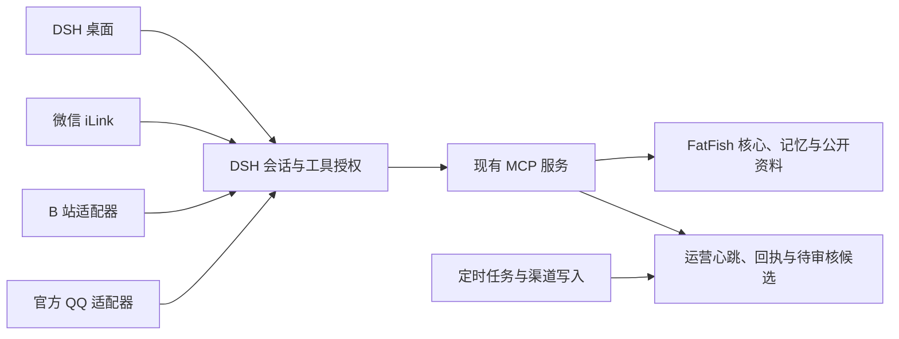

# FatFishLife 的 MCP 接入规范

## 架构



渠道各自校验账号、会话和平台许可。人格、B 站公开学习资料和授权范围内的记忆由同一核心提供。后台调度、平台传输和消息交付留在宿主，模型按授权通过 MCP 使用能力。

新版人设编辑、原生能力清单和按需渠道档案见 [小鱼人设与按需渠道](DSH_PERSONA.md)。

## 已采用的做法

| 参考 | FatFishLife 实现 |
| --- | --- |
| OpenClaw 健康检查 | `operations_overview(view="health")` 基于调度心跳区分就绪、过期、降级和未知，单独标出 QQ 暂停。微信、B 站当前无在线探测，返回 `not_probed`。 |
| n8n 工作流回执 | `view="receipts"` 返回已知任务最近一次状态、时间、发送条数及模型尝试数，能区分跳过、失败和结果未知。未知结果沿用原调度占位，避免补发。 |
| Hermes Curator | `view="skills"` 只列出有三次不同调度槽真实完成证据的工作流。候选由人审核，模型不能自动安装、启用或提权。 |
| AstrBot Adapter、Letta 记忆 | 沿用独立的渠道适配器和现有 SQLite 记忆。跨平台共享限于授权资料，私有会话记忆使用完整会话归属。原生闲时压缩仍需另验覆盖回执。 |

本次从这些项目借鉴设计，未复制它们的源码或引入第二套宿主。微信适配继续复用固定版本 `dsh-wechat 0.3.7`，由本仓库脚本基于锁定上游包构建，保留其 MIT 许可证原文。后续复用源码须在维护文件记录上游 URL、提交或版本、许可证、改动和验证方式，并随分发保留许可证及必要署名。

[OpenClaw Health](https://docs.openclaw.ai/gateway/health) · [n8n 工作流错误处理](https://docs.n8n.io/build/flow-logic/handle-errors-gracefully/) · [Hermes Curator](https://hermes-agent.nousresearch.com/docs/user-guide/features/curator) · [AstrBot](https://github.com/AstrBotDevs/AstrBot) · [Letta](https://github.com/letta-ai/letta) · [dsh-wechat 固定上游](https://github.com/zgat/dsh-wechat/tree/8213a830351753f128926b535693355b2f77763e)

## 新功能如何接入

1. **复用现有服务。** 工具优先挂到现有 MCP server，使用稳定的能力名称、对象输入和有界参数；本机使用 stdio。成功返回带 `outputSchema` 的 `structuredContent`，可预期工具失败使用 `isError`。省略原始异常、凭据、私聊正文和本地敏感路径。
2. **在执行入口检查权限。** 先按可信渠道、账号、会话和操作筛选工具，再在执行时验证同一权限。MCP 注解是描述信息。来自聊天、网页、昵称、二维码的内容不能授予权限。微信绑定私聊当前只启用文字回复与固定命令；管理工具由 DSH 本机调用。LifePilot 的现有私有授权单独维护。官方 QQ 保留现有配置状态。
3. **给写操作真实回执。** 发送、发布、付款和本机写入沿用既有审批。可重复触发的流程在写操作前保存去重键，完成后保存经平台确认的回执。暂停、明确拒绝、额度用尽和结果未知都终止当前任务，结果未知时保留待核对状态。
4. **先规定开销后接模型。** 只读自检、权限判断和候选筛选默认零模型。仅给模型提供本次能用的工具，用稳定前缀和有限资料。FatFish 控制层直连生成每任务至多一次尝试，微信每条消息至多两步，遇请求错误不重试。超限时用固定角色短句向当前主人回复，日志只记时间、错误类别和步数，不额外调用模型。独立插件的定时模型与普通桌面会话须各自核算。
5. **分层验收。** 先跑 MCP SDK 的握手、列工具、成功与非法参数测试，再在隔离 DSH 验证可见性、执行拒绝和重试计数，最后在正常退出、备份和重启后确认日常包版本与心跳。按平台记录真实账号验收；模拟回执仅证明测试链路。

[MCP 2025-11-25 工具规范](https://modelcontextprotocol.io/specification/2025-11-25/server/tools)

## 复查命令

```powershell
node scripts/dsh_token_audit.mjs
./.tools/dsh-python/Scripts/python.exe -m unittest discover -s tests -p test_operational_mcp.py
node --test dsh/tests/operations.test.mjs
```

用量报告来自已有 DSH 请求记录，分别统计缓存命中、非缓存输入和输出。报告没有账单字段，独立插件直连提供商也可能没有 DSH 请求记录。实际扣款以提供商账单为准。

## 2026-11-20 验收

- 历史样本包含一个带 165 项工具的桌面请求，共 49,706 token，缓存命中为 0。微信 28 轮里单次最多附带 119 项工具。另一个鲸鲸工作会话的最长回合走了 51 步。该工作会话 50 轮合计约 7,346 万 token，约 7,109 万来自缓存读取。普通桌面会话仍按宿主的工具门禁和预算运行。
- DSH rc.5 隔离宿主内，微信正常回复只发起一次模拟请求，故意重复触发的回合在两次模拟请求后停止。模型收到的工具定义、越权工具执行、付费请求和真实发送均为 0。MCP SDK 验证 FatFish 48、LifePilot 4 个工具，检查项目含结构化结果、非法输入、只读门禁及回执脱敏。
- 日常 DSH 由正常退出后安装控制包 `2e835f59a8e5` 与微信包 `1310586ea466`，保留 35 个 bundle 的成员和顺序及原 profile 配置。重启后桌面窗口响应、控制层心跳和微信状态已刷新。本机 MCP 查询返回调度就绪、QQ 暂停。真实微信回复、B 站/QQ 账号端和改动后的实际账单未验。

本机数字回执在 `outputs/dsh-migration/mcp-ops-20261120/`。回退时先从托盘退出 DSH，参照该目录的 `desktop-install.json` 找到备份和原依赖声明，再用随包插件管理器分别重装旧包，检查 bundle 顺序和配置差异后启动。
